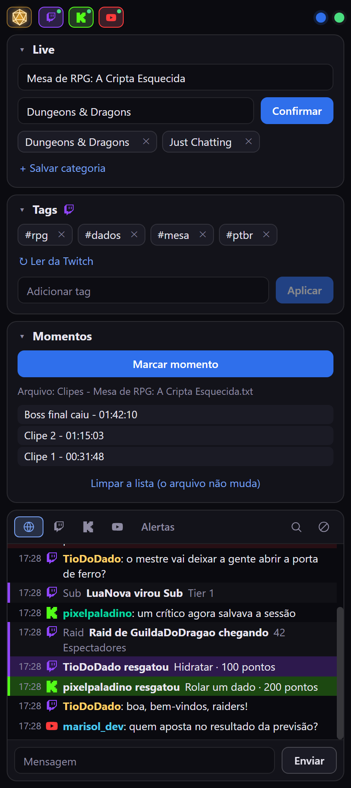
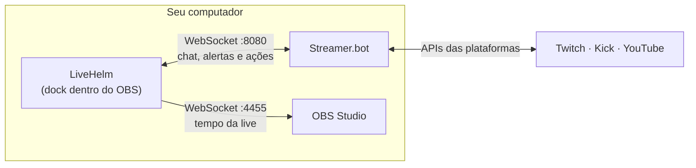
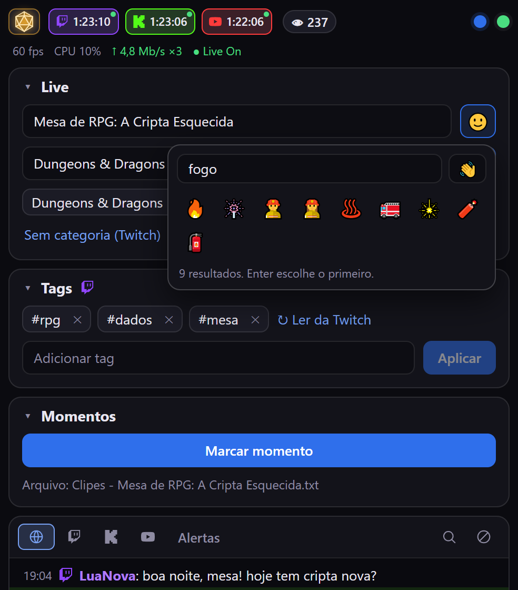
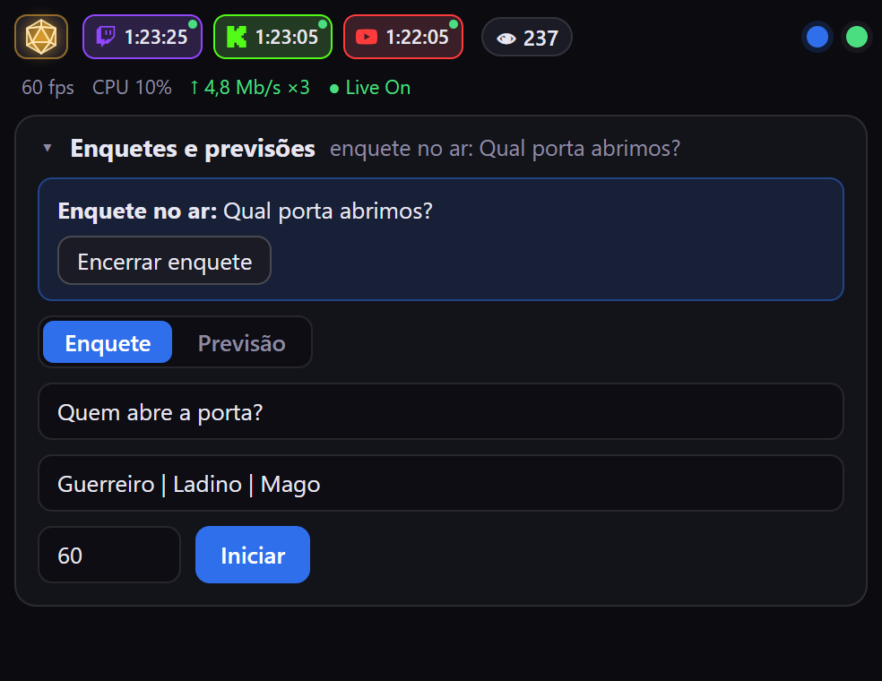
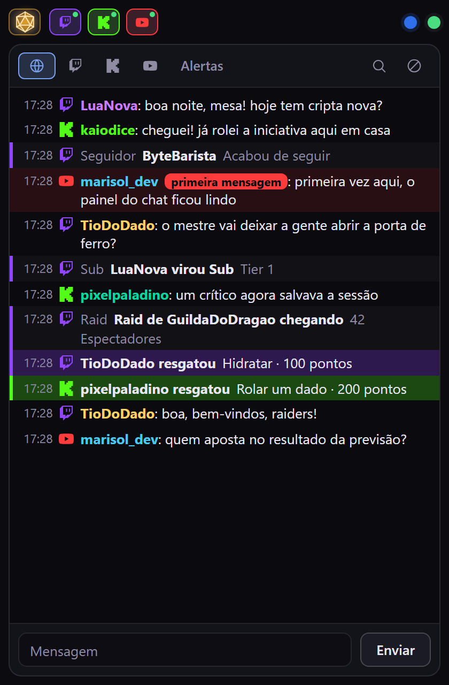
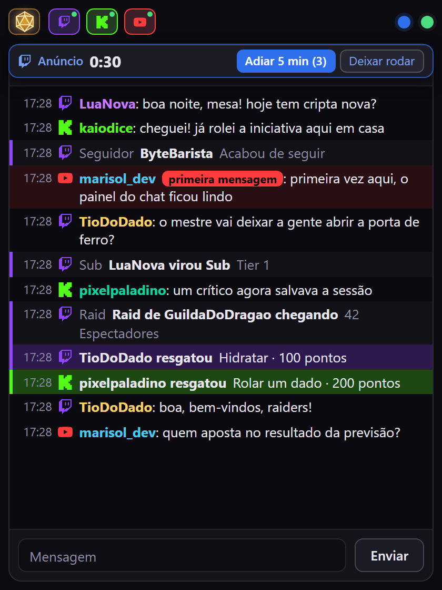
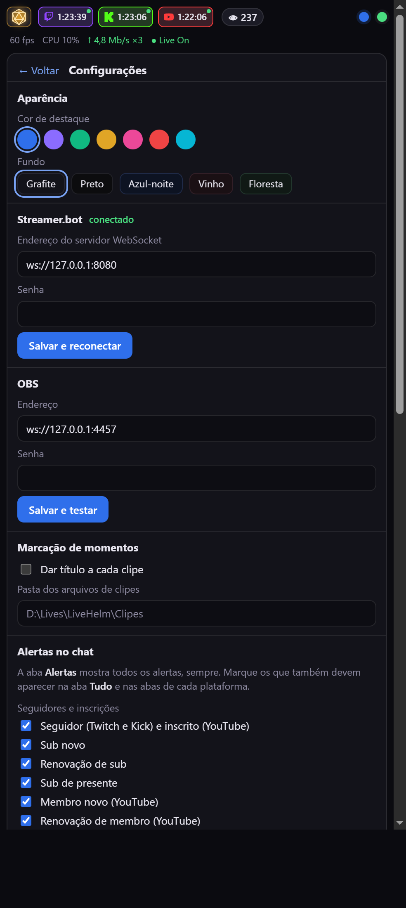
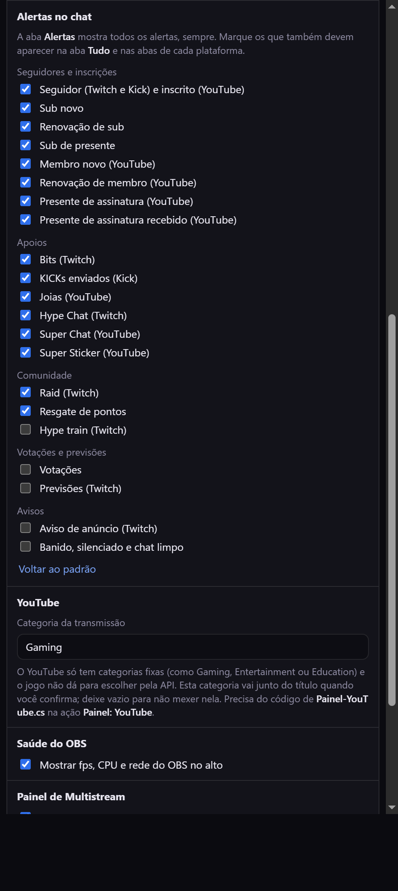
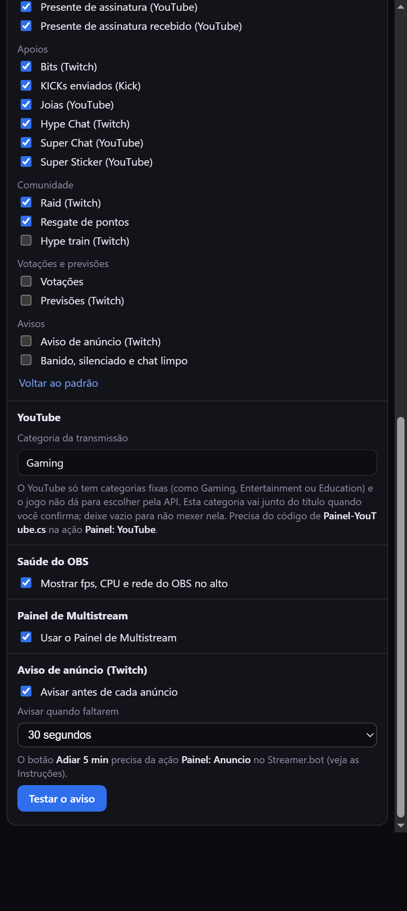

<p align="center">
  
</p>

# LiveHelm

**O painel de controle da sua live, dentro do OBS.**

Título e categoria nas três plataformas, tags da Twitch, marcação de momentos, enquetes e previsões, a saúde da transmissão, os
botões de iniciar e parar a live e um chat unificado de **Twitch, Kick e YouTube** com moderação, tudo num *dock* do OBS. Sem programa extra aberto, sem plugin para compilar e sem
nada que possa derrubar o OBS.

O LiveHelm é uma página web de arquivo único (`livehelm.html`) que o OBS abre como dock de navegador. Ela conversa com o
[**Streamer.bot**](https://streamer.bot), que fala com as plataformas, e com o próprio **OBS** para ler o tempo da live. Tudo roda
no seu computador: não há servidor, conta, cadastro nem chave de API.

> **Instalou e quer só configurar?** Vá direto para as [**Instruções**](docs/INSTRUCOES.md), com o passo a passo do Streamer.bot,
> do OBS e do dock.

## Sumário

- [Destaques](#destaques)
- [Como funciona](#como-funciona)
- [Começando](#começando)
- [Recursos](#recursos)
- [O que cada plataforma suporta](#o-que-cada-plataforma-suporta)
- [Configuração](#configuração)
- [Privacidade e segurança](#privacidade-e-segurança)
- [Limites conhecidos](#limites-conhecidos)
- [Desenvolvimento](#desenvolvimento)
- [Contribuindo](#contribuindo)
- [Licença e créditos](#licença-e-créditos)

## Destaques

- **Uma tela só** para o que você mexe durante a live: título, categoria, tags, momentos, enquetes e chat.
- **Três plataformas juntas:** Twitch, Kick e YouTube. Ligue ou desligue cada uma no alto; o que você faz vale só para as ligadas.
- **Confirmação de verdade:** depois de mudar título e categoria, o painel espera a plataforma avisar e mostra o que ela
  realmente aplicou (amarelo quando ficou diferente do digitado).
- **Chat com moderação:** apagar, silenciar e banir com um clique, desfazer punições, busca, filtro por usuário, mensagens
  fixadas e alertas no mesmo feed, com **resgates de pontos** (Twitch e Kick) em destaque e **você escolhendo** quais alertas
  aparecem em cada aba.
- **Aviso de anúncio da Twitch:** um pop-up pequeno com a contagem regressiva e o botão **Adiar 5 min**, para o anúncio não pegar
  você no meio de uma cena.
- **Tags da Twitch que você vê e edita:** o painel lê as tags atuais do canal, e você exclui ou adiciona antes de aplicar. Com **tags e descrição do YouTube** ligadas nas
  configurações (desligado por padrão), o mesmo painel ganha um bloco do YouTube: lê, edita e aplica as tags (palavras-chave escondidas) e a **descrição** da live, e guarda o que você
  escrever para aplicar quando a live abrir.
- **Título e categoria já preenchidos:** ao conectar, o painel lê o título e a categoria atuais da Twitch (e o título do YouTube, de
  reserva) e põe nos campos. O título aceita **emojis**, com busca em português e inglês.
- **Saúde da transmissão:** fps, CPU e upload do OBS num aviso em português simples (**Live On** ou o que está dando errado), o tempo de
  live de cada plataforma e o total de espectadores de todas, com o detalhe de cada uma ao passar o mouse.
- **Multistream:** botões **Iniciar lives** e **Parar lives** que fazem o mesmo que os do OBS (os destinos do plugin
  obs-multi-rtmp vão junto) e, no parar, esperam o delay da transmissão terminar em vez de cortar tudo.
- **AutoMod da Twitch:** a mensagem que o AutoMod segurou aparece no chat com **Permitir** e **Negar**.
- **Marcação de momentos:** um clique anota o tempo da live num arquivo de texto, para você achar os melhores trechos depois. Com o **botão de clipe** ligado
  (símbolo da Twitch), um clique também cria um clipe da live na Twitch e mostra o link.
- **Predefinições de live** (desligadas por padrão): guarde um modo (título, categoria, tags da Twitch e, se quiser, a categoria do YouTube) e troque de live
  com um clique, sem redigitar tudo.
- **Modos do chat da Twitch** (desligados por padrão): só emotes, modo lento, só seguidores e só inscritos num toque, sem ir ao site da Twitch. O Streamer.bot
  só tem esses controles na Twitch; a Kick e o YouTube não têm.
- **Mudo do microfone** (desligado por padrão): uma caixinha sempre visível no alto, ao lado esquerdo da bolinha azul (verde com o microfone aberto, vermelha no mudo), que coloca no mudo (e tira) o microfone que você escolheu nas configurações, pelo
  OBS, em vez de procurá-lo no mixer.
- **Instala em dois cliques** (Windows) e **não precisa de nada instalado** além do OBS e do Streamer.bot.
- **Leve e à prova de erro:** é só uma página; se algo falhar, o OBS continua funcionando.
- **Gratuito e com código disponível**, em React, com testes e documentação para quem quiser usar, estudar e adaptar.

## Como funciona



1. **O dock** é a interface. Ele roda dentro do OBS, no navegador embutido, e guarda suas preferências (painéis, tema,
   atalhos) no armazenamento dele.
2. **O Streamer.bot** é a ponte. O dock se conecta ao servidor WebSocket dele e **recebe** os eventos (mensagens, seguidores,
   inscrições, raids, enquetes...) e **pede** coisas executando *ações* (mudar o título, banir, enviar mensagem...). Essas ações
   são criadas uma vez no Streamer.bot, com nomes fixos (`Painel: Twitch`, `Painel: Chat`...), e o código das que precisam de C#
   vem pronto neste projeto, na pasta [`acoes-streamerbot/`](acoes-streamerbot).
3. **O OBS** só entra na marcação de momentos: na hora de marcar, o dock pergunta ao servidor WebSocket do OBS há quanto tempo
   a live (ou a gravação) está no ar.

Como um navegador não grava arquivos no disco, a anotação dos momentos é escrita pelo Streamer.bot, por uma ação. Todo o resto
fica no dock.

## Começando

Você precisa do **OBS Studio 28 ou mais novo** e do **Streamer.bot** (testado na versão 1.0.7), no Windows.

1. **Streamer.bot:** entre com a conta de cada plataforma e ligue o servidor WebSocket (`Servers/Clients > WebSocket Server`).
2. **Ações:** crie no Streamer.bot as ações `Painel: ...` que o dock usa, com o nome **EXATAMENTE igual** ao das Instruções (as de C# são só colar o código da pasta
   [`acoes-streamerbot/`](acoes-streamerbot)).
3. **Dock:** feche o OBS e rode o **`Instalar LiveHelm.exe`** (da página de *Releases*, ou gerado com
   [`npm run instalador`](#desenvolvimento)). Abra o OBS: o dock **LiveHelm** aparece na janela.
4. **Conferir:** a bolinha no canto de cima do dock fica verde quando tudo está conectado.

O passo a passo completo, com onde achar cada coisa em cada programa, está nas [**Instruções**](docs/INSTRUCOES.md). Quer instalar
sem o instalador (ou fora do Windows)? As Instruções também explicam o jeito manual, por **Docks > Custom Browser Docks**.

## Recursos

### Barra de cima

Da esquerda para a direita:

- O **d20**, a chave global das plataformas: com todas ligadas ele *brilha* e um clique desliga todas; senão fica apagado e um
  clique liga todas.
- **Twitch, Kick e YouTube.** Ligar ou desligar vale para atualizar a live e para enviar mensagens. O pontinho verde diz se o
  Streamer.bot está conectado àquela plataforma.
- O **tempo de live** ao lado do símbolo de cada plataforma (00:00 com a live desligada) e o **total de espectadores** de todas; ao passar o
  mouse no total, um cartãozinho mostra o número de cada plataforma. O tempo da Twitch vem da transmissão do OBS e o do YouTube e da Kick, do
  aviso de início de cada uma ou, na falta dele, dos destinos do multistream que estão no ar. **Quem manda no "no ar" é o OBS** (com o
  WebSocket dele conectado): quando ele para de transmitir, os três tempos voltam a 00:00 e os espectadores a 0 na hora, sem esperar o aviso de
  cada plataforma (que a Kick e o YouTube nem sempre mandam). Sem a leitura do OBS, valem os avisos das plataformas.
- Logo abaixo, a **linha de saúde do OBS** (veja [Saúde do OBS e Multistream](#saúde-do-obs-e-multistream)).
- A **bolinha azul** abre a lista de painéis, para mostrar ou esconder cada um (a escolha fica salva).
- A **bolinha de estado**: **verde** (Streamer.bot e todas as plataformas ativas conectados), **amarela** (falta alguma plataforma
  ativa) ou **vermelha** (sem Streamer.bot, ou ele recusou a conexão). Passe o mouse para ver o motivo; clique para abrir as
  configurações.

### Live: título e categoria

Um campo de título, um de categoria e o botão **Confirmar**, que atualiza todas as plataformas ligadas ao mesmo tempo.

- Todas as plataformas vão **ao mesmo tempo** e cada resultado aparece assim que chega (em até uns 3 s), numa linha curta num cartão que **flutua**
  embaixo do painel Live, sem empurrar os painéis de baixo (clique nele para fechar; some sozinho em 10 s; o erro fica). Por exemplo: "atualizado",
  "alterado (sem confirmação)" (a Kick não confirma, então fica amarelo) ou "sem live aberta (aplico ao abrir)" (YouTube). O resultado aparece **por plataforma**: ✓ quando a plataforma confirmou, e amarelo quando a categoria ou o título ficou
  diferente do digitado ou a plataforma não confirmou (por exemplo, uma categoria que não existe).
- **+ Salvar categoria** cria um atalho de um clique. As categorias que as plataformas já confirmaram viram sugestões enquanto
  você digita.
- Ao conectar, o painel **lê o título e a categoria atuais da Twitch** e os põe nos campos (sem título na Twitch, usa o do YouTube; a
  Kick não deixa o Streamer.bot lê-los). Se você já digitou algo, a leitura não passa por cima. Isso pede o código novo da ação
  `Painel: Tags` (veja as [Instruções](docs/INSTRUCOES.md)); sem ele, valem os valores lembrados da última vez.
- O botão 🙂 abre o **seletor de emojis** do título: busque por texto (por exemplo "fogo", "coração" ou "dado", em português ou em
  inglês) e aperte **Enter** para pegar o primeiro, ou navegue pelas abas. O 👋 troca o tom de pele. Só aparecem os emojis que o seu
  sistema sabe desenhar.
- **YouTube:** o título é ajustado às regras dele (`->` vira `→`, `<` e `>` saem, até 100 caracteres) e o resultado diz o que mudou.
  Com o código novo da ação `Painel: YouTube`, o painel mostra se o YouTube aceitou ou o motivo de não ter aceitado. A categoria do
  YouTube é uma da lista fixa dele e **muda sozinha conforme a live**: em Configurações > YouTube, cada linha tem as palavras que identificam um tipo de live
  (Just Chatting, Software/Tecnologia/Ciência, Música, Esportes...) e a categoria do YouTube, **escolhida numa lista** (nada de digitar o nome). O dock
  compara a categoria digitada no painel Live (ou, sem ela, o título) com as palavras; qualquer outro nome digitado é um jogo e vai para **Gaming**, sempre
  (a linha "Qualquer jogo" aceita nomes, como Marvel Rivals e Minecraft, que ganham das outras linhas). O resultado mostra a categoria quando uma regra a escolheu
  ("atualizado (People & Blogs)"). O jogo em si (o "Título do jogo" do YouTube Studio) **não dá para escolher**: nem a API do YouTube nem o
  Streamer.bot têm esse campo. O YouTube só
  muda o título de uma **transmissão que existe** (criada ou agendada no YouTube Studio, ou no ar) e que o Streamer.bot monitora: sem ela,
  o dock **guarda o título e o aplica sozinho quando a live do YouTube começar**, e mostra o resultado no painel.
- **Kick:** se a categoria não for aceita, o dock tenta outras grafias (por exemplo "Baldur's Gate 3" com o apóstrofo) e lembra a que
  funcionou.
- **Sem categoria (Twitch):** com a ação opcional `Painel: Sem Categoria` aparece um link que pede à Twitch para tirar
  a categoria.
- Título e categoria ficam lembrados entre uma live e outra. A seção recolhe para dar espaço ao chat.

<p align="center">
  
</p>

### Tags da Twitch

Um painel só para as tags (#), separado de título e categoria porque **só valem na Twitch** (o ícone da Twitch ao lado do nome
lembra disso).

- Ao abrir, o painel **lê as tags que o canal tem agora** e as mostra como etiquetas. **↻ Ler da Twitch** lê de novo.
- O **✕** exclui uma etiqueta; o campo **Adicionar tag** inclui novas com Enter (aceita `#rpg #dados` ou separadas por vírgula).
- As regras da Twitch são aplicadas na hora: sem `#`, espaços ou símbolos, até 25 letras ou números, no máximo 10, sem repetir.
- **Nada vale até o Aplicar**, que troca todas as tags do canal pela lista final (lista vazia remove todas). Dá para errar e
  voltar atrás antes de enviar.

### Momentos

Marca pontos da live para você achar depois (para clipes, cortes, capítulos).

- **Marcar momento** lê o tempo da transmissão no OBS (se não estiver transmitindo, o da gravação) e acrescenta uma linha em
  `Clipes - <título da live>.txt`: `Clipe 1 - 00:12:34`, `Clipe 2 - 00:40:10`...
- Em **Configurações**, **Dar título a cada clipe** liga um campo de título no painel (`Boss final caiu - 00:40:10`); deixado
  vazio, vale o `Clipe N` de sempre.
- A numeração e a lista da sessão ficam lembradas por arquivo. O arquivo vai para a pasta `Clipes` ao lado do dock, ou para a
  pasta que você escolher (um caminho completo de uma unidade local, como `C:\Clipes`).

### Enquetes e previsões (Twitch)

Escolha **Enquete** ou **Previsão**, escreva a pergunta, as opções (separadas por `|`) e a duração, e clique em **Iniciar**.
A que estiver no ar aparece no alto do painel com os controles: **Encerrar enquete**, **Travar apostas**, **Venceu: opção** e
**Cancelar previsão**. O painel já valida os limites da Twitch (enquete de 2 a 5 opções, previsão de 2 a 10, opções de até 25 letras).
Vem desligado: ligue-o pela bolinha azul.

<p align="center">
  
</p>

### Saúde do OBS e Multistream

Duas coisas separadas, cada uma com o seu interruptor em **Configurações**:

- **Saúde do OBS** (vem ligada; só lê o OBS): uma linha pequena logo abaixo da barra com **fps**, **CPU** e **upload** e, no fim, o
  estado da live: **Live On** (no ar e sem problemas), **Live Off** (nada no ar) ou, em português simples, o que está acontecendo (a
  internet oscilando, o PC com dificuldade de codificar o vídeo, o OBS travando). O **Live On/Off** fica sempre no mesmo lugar e o aviso aparece
  **ao lado dele**, em texto curto e numa linha só: a linha nunca cresce, então o chat e os painéis de baixo não se mexem quando a live trava
  (antes o aviso quebrava em várias linhas e empurrava tudo, parecendo uma mensagem nova). Se faltar espaço o texto corta com "…"; passe o mouse
  sobre ele para ver o aviso completo e o que ele quer dizer.
- **Painel de Multistream** (vem **desligado**, porque os botões mexem na live): **Iniciar lives** e **Parar lives**, com confirmação, que
  fazem o mesmo que Iniciar e Parar transmissão do OBS. Os destinos do plugin de multistream seguem junto quando ele está com
  *sincronizar início e fim*. O **Parar lives** não força: com **delay** de transmissão, o OBS termina de enviar o que está no delay antes
  de fechar, e o painel mostra "Parando… o OBS espera o delay terminar" até tudo fechar.

O dock lê o OBS pelo WebSocket dele (a mesma conexão das configurações). **Não há botões separados por plataforma** (iniciar ou parar só a
Kick, por exemplo): o plugin chama todos os destinos de `multi-output` e o OBS não deixa escolher um por fora; para isso use a janela do
plugin. A forma recomendada de montar: a **Twitch** como transmissão do próprio OBS e só **YouTube e Kick** no plugin.

### Chat

Mensagens e alertas das três plataformas num feed só, com abas **Tudo**, **Twitch**, **Kick**, **YouTube** e **Alertas**.

<p align="center">
  
</p>

- **Leitura:** cor do nome, insígnias e emotes (quando a plataforma os entrega como imagem), marca de **primeira mensagem** (a primeira de todas da pessoa no canal, não a da live) e
  mensagens apagadas ou de quem foi punido **riscadas**. O feed guarda as últimas 400 linhas.
- **Alertas** no mesmo feed: a aba **Alertas** mostra todos, sempre. A aba **Tudo** mostra, junto das mensagens, só o que importa
  na hora: seguidores, inscrições (novas, renovações e presentes), Bits, raids, resgates de pontos, Hype Chat, Super Chat, Super
  Sticker, presentes e membros. Hype train, enquetes e previsões, o **aviso de anúncio** (a Twitch avisa uma vez por minuto nos 5
  minutos antes) e os avisos de moderação (banido, silenciado, chat limpo) ficam só na aba **Alertas**. As abas **Twitch**,
  **Kick** e **YouTube** mostram o mesmo que a **Tudo**, só daquela plataforma. A lista de partida fica em
  [`src/alertas.js`](src/alertas.js).
- **Você escolhe o que aparece:** em **Configurações > Alertas no chat** (veja [abaixo](#configurações-e-tema)) cada tipo de alerta
  tem uma caixa que o liga ou desliga na **Tudo** e nas abas de plataforma. O botão **Voltar ao padrão** desfaz as suas escolhas.
- **Resgate de pontos:** vem da Twitch (as suas recompensas e as padrão, como mensagem em destaque, emotes e efeitos) e da Kick, e
  ganha um fundo na cor da plataforma para se destacar dos outros alertas. Os Power-ups pagos com Bits não chegam.
- **Aviso de anúncio (Twitch):** um pop-up compacto (uma linha) por cima do dock, com a contagem regressiva, quando faltam 15, 30, 45
  ou 60 segundos para o anúncio. **Adiar 5 min** empurra o anúncio (a Twitch só permite adiar, não cancelar, e enquanto houver
  adiamentos) pela ação `Painel: Anuncio`; **Deixar rodar** dispensa o aviso. Vem **desligado**, em **Configurações > Aviso de
  anúncio**, onde também há o botão **Testar o aviso**.

<p align="center">
  
</p>
- **AutoMod da Twitch:** a mensagem que o AutoMod segurou para revisão aparece no feed (abas Tudo, Alertas e Twitch) numa faixa âmbar,
  com o autor, o texto, o motivo e os botões **Permitir** e **Negar**. Depois que alguém decide, a faixa mostra o resultado. Pede o
  código novo da ação `Painel: Chat`. Kick e YouTube não têm isso no Streamer.bot.
- **Sub de presente:** o alerta diz quem presenteou e **para quem foi** (em presente em massa, a quantidade e os primeiros nomes).
- **Moderação:** passando o mouse numa mensagem aparecem **Banir** (com confirmação), **Silenciar 5 min** e **Apagar** (não existe
  no YouTube), mais o **⋮** com todas as opções. O botão direito abre o mesmo menu: Mencionar, Copiar mensagem, Apagar,
  Silenciar 1 ou 10 minutos, Banir, Fixar e Ver só este usuário.
- **Enviar mensagens:** a caixa de baixo envia para as plataformas ligadas (ou só para a da aba aberta). Aceita comandos:
  `/ban nome`, `/timeout nome segundos` (10 min se não disser o tempo), `/limpar` (limpa o chat da Twitch) e `/limpardock` (esvazia só a lista de
  mensagens do LiveHelm; não apaga nada nas plataformas).
- **Texto de resgate sem repetir:** a mensagem em destaque (e a recompensa que pede texto) aparece só como resgate, com o texto; a mensagem igual do
  chat, que chega junto, não entra de novo.
- **Busca** (lupa ou `Ctrl+F`): filtra por nome ou texto, sem diferenciar maiúsculas nem acentos. **Ver só este usuário** mostra só as
  mensagens dele, com um chip para soltar. `Esc` ou **Fechar** limpa tudo.
- **Fixar mensagem:** até 3 ficam num quadro no alto do chat, só na sessão.
- **Silenciados e banidos** (botão ⊘ ao lado da lupa, com o número): a lista da sessão, com o que você fez e o que as plataformas
  avisaram, com **Desbanir** ou **Liberar** (Twitch e Kick).

### Configurações e tema

Clique na bolinha de estado.

<p align="center">
  
</p>

- **Aparência:** 7 cores de destaque e 5 fundos (Grafite, Preto, Azul-noite, Vinho e Floresta). A mudança é na hora.
- **Streamer.bot:** endereço e senha do servidor WebSocket, com **Salvar e reconectar**.
- **OBS:** endereço e senha do servidor WebSocket do OBS, com **Salvar e testar**, que mostra o tempo atual da live.
- **Marcação de momentos:** título de clipe e pasta dos arquivos.
- **Alertas no chat:** uma caixa por tipo de alerta (seguidor, sub, Bits, raid, resgate de pontos, anúncio, banimento...) para
  decidir se ele aparece na aba **Tudo** e nas abas de plataforma. A aba **Alertas** mostra todos, sempre. As escolhas valem na
  hora, e **Voltar ao padrão** desfaz tudo.
- **YouTube:** a categoria da transmissão que vai junto do título (padrão Gaming; vazio não mexe nela).
- **Saúde do OBS** e **Painel de Multistream:** um interruptor para cada um (a saúde vem ligada e o multistream, desligado). O dock também
  avisa aqui quando o seu canal da Twitch ainda não é afiliado nem parceiro: sem isso a Twitch não tem pontos do canal, e por isso nem
  resgates nem alertas deles.
- **Aviso de anúncio (Twitch):** liga o pop-up, escolhe com quantos segundos de antecedência ele aparece (15, 30, 45 ou 60) e tem o
  botão **Testar o aviso**.

<p align="center">
  
  
</p>

O dock é pensado para ficar **estreito**: ele aguenta ser a coluna ao lado do preview do OBS, com o chat ocupando o que sobrar.

## O que cada plataforma suporta

| Recurso | Twitch | Kick | YouTube |
|---|:---:|:---:|:---:|
| Ler o chat e receber alertas | ✓ | ✓ | ✓ |
| Enviar mensagens | ✓ | ✓ | ✓ |
| Título da live | ✓ | ✓ | ✓ |
| Categoria (o jogo) | ✓ | ✓ | — (só as fixas, como Gaming) |
| Ler o título e a categoria atuais | ✓ | — | só o título |
| Tags (ler e editar) | ✓ | — | — |
| Apagar mensagem | ✓ | ✓ | — |
| Silenciar e banir | ✓ | ✓ | ✓ |
| Desfazer silêncio e banimento | ✓ | ✓ | — |
| Limpar o chat (`/limpar`) | ✓ | — | — |
| Criar e controlar enquetes e previsões | ✓ | — | — |
| Ver resgates de pontos no chat | ✓ | ✓ | — |
| Aviso de anúncio, com adiamento | ✓ | — | — |
| Ver e liberar mensagens retidas pelo AutoMod | ✓ | — | — |
| Tempo de live e espectadores | ✓ | ✓ | ✓ |

Os "—" são limites das plataformas ou do Streamer.bot 1.0.7, não do LiveHelm: onde a plataforma ou o Streamer.bot não oferece o
recurso, o dock deixa o botão desligado ou ignora a plataforma.

## Configuração

- **Pela tela de configurações** (bolinha de estado): endereço e senha do Streamer.bot e do OBS, tema, momentos, os alertas que
  aparecem no chat e o aviso de anúncio. Tudo fica guardado no armazenamento do navegador do dock, dentro do OBS.
- **Valores de partida:** [`src/config.js`](src/config.js) tem o endereço e a senha padrão do Streamer.bot (`ws://127.0.0.1:8080`) e do
  OBS (`ws://127.0.0.1:4455`). As senhas vêm **vazias**. Se você gerar o seu próprio build, não coloque senhas reais no arquivo
  se for publicá-lo em algum lugar.
- **Pela URL do dock**, para testes: `?streamerbot=ws://IP:PORTA` e `?sbsenha=SENHA` valem no lugar do que está salvo.
- **Streamer.bot em outro computador:** veja as [Instruções](docs/INSTRUCOES.md#streamerbot-em-outro-computador).

## Privacidade e segurança

- O LiveHelm **não envia nada para a internet**. Ele conversa só com o Streamer.bot e o OBS, que normalmente estão no seu
  computador (`127.0.0.1`).
- As senhas que você digita nas configurações ficam salvas, **em texto simples**, no armazenamento do navegador do dock (no seu
  perfil do OBS). Não use a mesma senha de outras contas.
- **Use senha** no servidor WebSocket do Streamer.bot (**Authentication**), mesmo só no seu computador: quem conseguir conectar nele
  pode pedir as ações do dock (banir, enviar mensagem, gravar a anotação de um momento). Deixe o endereço em `127.0.0.1`; para
  abri-lo para a rede, a senha é indispensável.
- As ações validam o que recebem: a `Painel: Momentos`, por exemplo, só grava arquivos `.txt` em pasta local com letra de unidade
  (sem caminho de rede nem `..`).
- Evite `?sbsenha=` na URL do dock fora de testes: a URL fica visível nas configurações de docks do OBS.
- **Banir** pede confirmação no dock. Revise a constante `USAR_BOT` da ação `Painel: Chat` para saber com qual conta (a sua ou a
  do bot) as mensagens e punições saem.

## Limites conhecidos

- **Streamer.bot 1.0.7 e OBS 32** são as versões em que o projeto foi testado. Outras podem funcionar, mas não foram conferidas.
- Dos eventos do Streamer.bot, foram conferidos com dados reais as mensagens da Twitch e da Kick e o seguidor da Twitch. Os demais
  alertas (Kick, YouTube, subs, raids, hype train...) seguem a documentação e são lidos de forma tolerante: se um campo não vier, o
  texto fica sem aquele detalhe. Se algum alerta aparecer errado ou não aparecer, abra uma *issue* com o evento do log do Streamer.bot.
  Isso vale em especial para o **resgate de pontos da Kick** e para o **aviso de anúncio** da Twitch, escritos pela documentação do
  Streamer.bot e ainda sem teste com dados reais de todos os casos.
- **Anúncio da Twitch:** só dá para **adiar** (em 5 minutos, e enquanto a Twitch ainda deixar), nunca cancelar. O Streamer.bot não
  avisa de anúncios da Kick nem do YouTube, e o botão **Adiar 5 min** depende da ação `Painel: Anuncio` e da permissão de
  gerenciar anúncios na conta da Twitch.
- **YouTube:** o Streamer.bot só controla uma transmissão que ele está monitorando (a live precisa estar criada e o YouTube conectado
  nele). Sem o código novo de `Painel: YouTube`, o dock não consegue saber se o título mudou e o aviso diz isso. O título tem as
  regras do YouTube (sem `<` e `>`, até 100 caracteres) e a categoria é uma da lista fixa dele.
- **AutoMod e categoria vazia:** o Permitir e Negar do AutoMod segue a documentação do Streamer.bot (os campos exatos do evento ainda
  não foram vistos com dados reais), (o **Sem categoria** da Twitch já foi testado e funciona).
- **Multistream:** não existe iniciar ou parar um destino só; o plugin obs-multi-rtmp não tem API e todos os destinos têm o mesmo nome.
- O dock não mostra avatares, e emotes de terceiros (7TV, BetterTTV, FrankerFaceZ) não são carregados: só os que a plataforma
  entrega no evento.
- O instalador automático é só para **Windows** (o Streamer.bot também roda só nele). O dock em si é uma página e funciona em qualquer
  OBS pelo jeito manual.
- O navegador embutido do OBS pode se comportar diferente do Chrome em detalhes: confira, por exemplo, se **Copiar mensagem**
  funciona no seu OBS.

## Desenvolvimento

Precisa do **Node.js 18 ou mais novo**. Para gerar o instalador, do **.NET SDK** (só para compilar; o `.exe` pronto roda com o .NET
Framework 4.8, que já vem no Windows 10/11).

```bash
npm install
npm run dev          # http://localhost:5173/livehelm.html, com hot-reload
npm test             # testes das regras puras (node --test, sem dependências)
npm run build        # gera dist/livehelm.html, o arquivo único que o OBS abre
npm run instalador   # build + "Instalar LiveHelm.exe" (com o dock dentro), na raiz do projeto
```

`npm run dev` precisa do Streamer.bot aberto para ter dados; para testar sem ele, dá para apontar o dock para um servidor
WebSocket de mentira com `?streamerbot=ws://127.0.0.1:PORTA`.

### Estrutura

```
livehelm.html            Entrada do Vite
src/main.jsx             Monta o App (sem React.StrictMode: ele abriria a conexão duas vezes)
src/App.jsx              Barra de cima (plataformas, estado) e a lista de painéis
src/LivePanel.jsx        Título, categoria, atalhos e o resultado da atualização
src/Tags.jsx             Tags da Twitch (ler, excluir, adicionar, aplicar)
src/tagsLista.js         Regras puras da lista de tags e a leitura das respostas do Streamer.bot (tags, canal, YouTube; testadas)
src/titulos.js           Regras de título e categoria: título do YouTube e outras grafias de categoria (puro; testado)
src/Emojis.jsx           Seletor de emojis do título (busca, abas, tom de pele); emojiBusca.js, emojiSuporte.js e emojisDados.js
src/lives.js             Estado das lives (espectadores, início, saúde): puro e testado
src/obsSaude.js          Leitura contínua do OBS (fps, CPU, rede), iniciar e parar a transmissão
src/SaudeDoObs.jsx       Linha de saúde do OBS; PainelMultistream.jsx tem os botões Iniciar e Parar lives; TempoDeLive.jsx o tempo
src/Momentos.jsx         Marcação de momentos
src/pastaClipes.js       Regra da pasta dos clipes (a mesma da ação C#; testada)
src/Interacoes.jsx       Enquetes e previsões
src/ChatPanel.jsx        Feed, abas, menu, moderação, busca e caixa de envio
src/alertas.js           Quais alertas entram em cada aba do chat e o catálogo de tipos de alerta (puro; testado)
src/AvisoAnuncio.jsx     Pop-up do aviso de anúncio da Twitch (contagem, Adiar 5 min, Deixar rodar)
src/anuncios.js          Regras puras do aviso de anúncio: quando mostrar, adiar, dispensar (testado)
src/Configuracoes.jsx    Tela de configurações (tema, conexões, momentos, alertas no chat, aviso de anúncio)
src/acoes.js             Pedidos de ações ao Streamer.bot (os nomes e argumentos que as ações C# leem)
src/streamerbot.js       Conexão WebSocket (senha, reconexão) e conversão dos eventos em tipos do dock
src/obs.js               Tempo da live pelo obs-websocket v5
src/configuracoes.js     Configuração salva e tema
src/config.js            Endereços e senhas de partida
src/punicoes.js, texto.js, plataformas.js, armazenamento.js, Icones.jsx, Listas.jsx, style.css
acoes-streamerbot/       Código C# das ações (para colar no Streamer.bot)
instalador/              Instalador (C#, .NET Framework 4.8): leva o dock dentro e o registra no OBS
tests/                   Testes (node --test)
docs/INSTRUCOES.md       Passo a passo de instalação e configuração
```

### Como estender

- **Novo painel:** crie o componente em `src/`, registre em `PAINEIS` e no estado `paineis` do `App.jsx` (a chave de visibilidade) e
  renderize-o ali. Guarde preferências com `ler`/`gravar` de `armazenamento.js` (prefixo `livehelm.`).
- **Nova ação do Streamer.bot:** escreva o C# em `acoes-streamerbot/`, adicione o pedido em `acoes.js` com **os mesmos nomes de
  argumentos** do C# e documente a ação na tabela de [`docs/INSTRUCOES.md`](docs/INSTRUCOES.md). Coloque a lógica que não depende de
  rede nem de React em módulos puros (como `tagsLista.js`) e teste em `tests/`.
- **Novo alerta ou evento:** acrescente o evento em `EVENTOS_ASSINADOS` e a conversão em `ALERTAS` (`src/streamerbot.js`), o rótulo
  em `ROTULO_DO_ALERTA` (`ChatPanel.jsx`) e o tipo em `TIPOS_DE_ALERTA` (`src/alertas.js`), para ele ganhar a caixa em
  **Configurações > Alertas no chat**. Ele só entra na aba **Tudo** por padrão se também estiver em `ALERTAS_NO_CHAT_GERAL`.
- **Nova opção de configuração:** é uma seção nova em `configuracoes.js` (o padrão vale seção por seção) e um bloco em
  `Configuracoes.jsx`.

Mais regras para quem mexe no código estão no [`CLAUDE.md`](CLAUDE.md) (que também orienta assistentes de código).

## Contribuindo

Contribuições são bem-vindas: correções, novos recursos, testes e melhorias nas Instruções.

1. Abra uma *issue* descrevendo o problema ou a ideia (para bugs, diga as versões do OBS e do Streamer.bot e, se puder, o trecho
   relevante do log do Streamer.bot).
2. Faça o *fork*, crie uma branch e mexa seguindo as regras do [`CLAUDE.md`](CLAUDE.md).
3. Rode `npm test` e `npm run build` antes de abrir o *pull request*.
4. Se mudou o comportamento, atualize este README e as [Instruções](docs/INSTRUCOES.md) na mesma contribuição.

## Licença e créditos

O LiveHelm é **gratuito**. Você pode usar, modificar e compartilhar, com dois pedidos:

- **Não venda** o LiveHelm, nem versões dele com pequenas mudanças.
- **Dê os créditos a Gustavo Boschini Rossetti**, o autor original, e deixe o link do repositório original em versões modificadas.

Os detalhes estão no arquivo [`LICENSE`](LICENSE).

**Autoria:** Gustavo Boschini Rossetti, com coautoria do [Claude](https://www.anthropic.com/claude), assistente de IA da Anthropic.

O LiveHelm não é afiliado ao OBS Project, ao Streamer.bot, à Twitch, à Kick nem ao YouTube. Construído com [React](https://react.dev) e [Vite](https://vitejs.dev), conversando com o [Streamer.bot](https://streamer.bot) e o [obs-websocket](https://github.com/obsproject/obs-websocket).